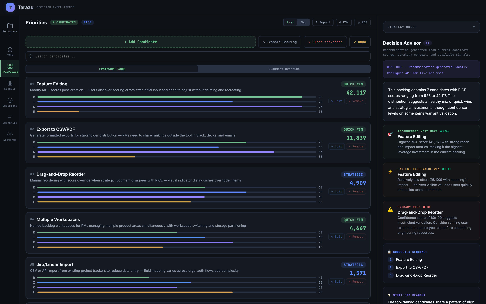
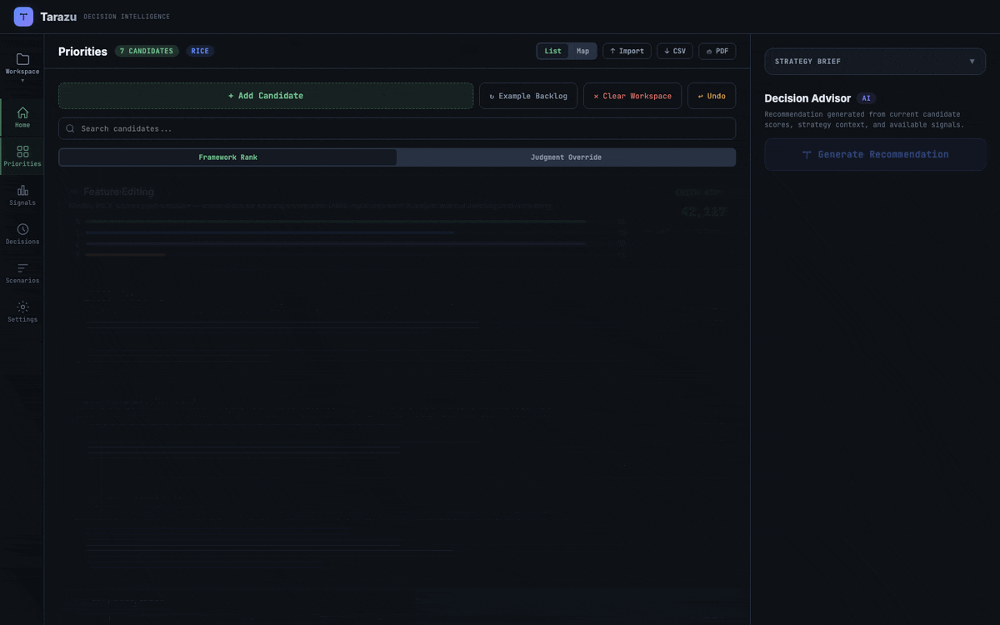
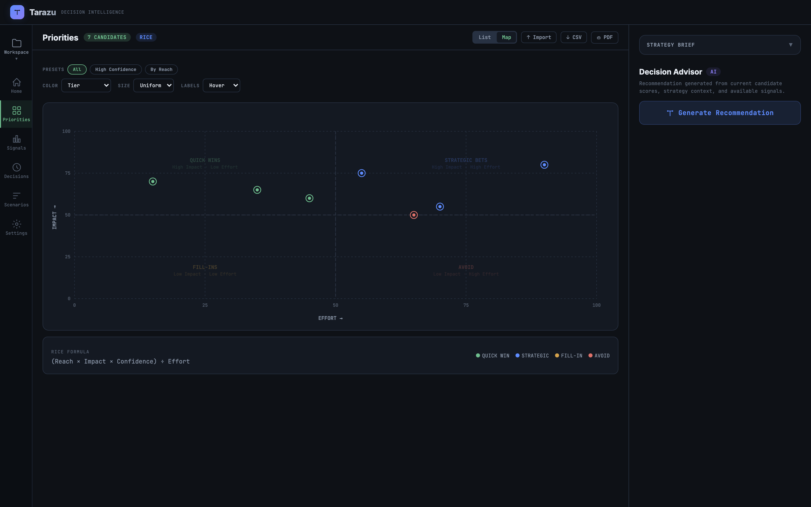
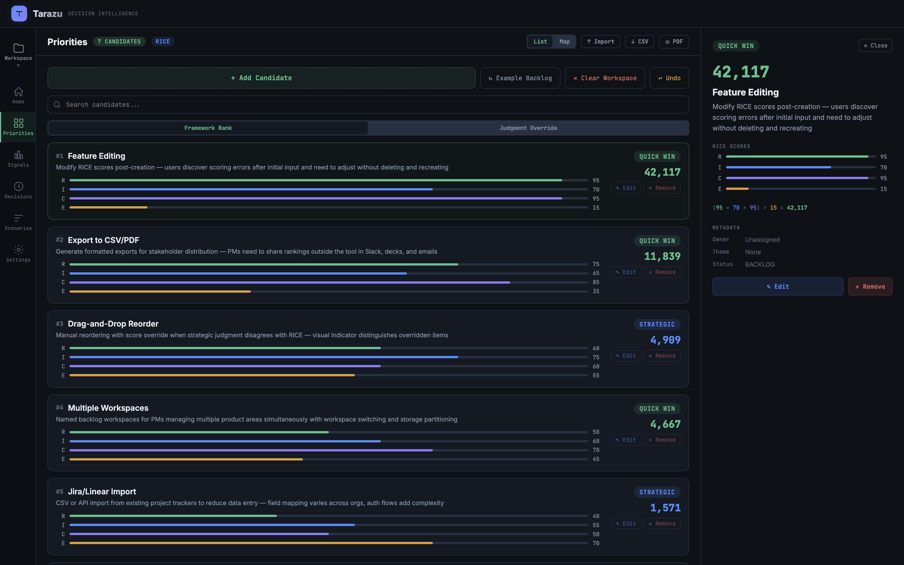
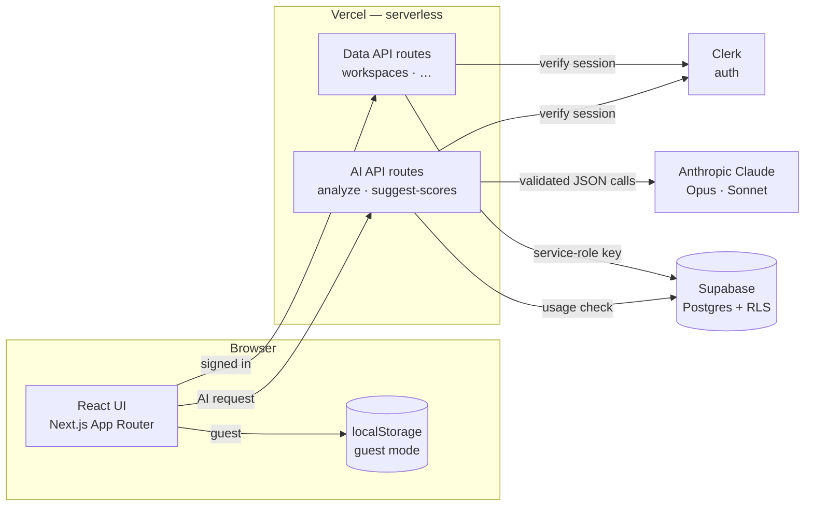

# Tarazu

**Decision intelligence for product teams. Weigh what matters.**

Tarazu — from the Hindi/Urdu word for a balance scale — helps product teams prioritize ideas, compare tradeoffs, capture context, and generate explainable recommendations with structured frameworks like RICE — powered by Claude.

**[tarazu.app](https://tarazu.app)** · Free. Guest scoring runs in your browser without an account; AI requires sign-in and an internet connection.

[How it works](https://tarazu.app/how-it-works) · [RICE scoring guide](https://tarazu.app/frameworks/rice) · [vs. spreadsheets](https://tarazu.app/vs/spreadsheets) · [FAQ](https://tarazu.app/faq) · [Pricing](https://tarazu.app/pricing)



*Historical UI capture: RICE-scored candidates on the left, the AI Decision Advisor's recommendation on the right. [Try it live →](https://tarazu.app)*

---

## What It Does

| Feature | Description |
|---------|-------------|
| **Normalized RICE Scoring** | Band-based adaptation of RICE: 1–100 inputs, shared definitions and selected recorded claims; a relative index, not ROI |
| **Priority Matrix** | Canvas-rendered Effort vs. Impact scatter plot with labeled quadrants |
| **AI Strategy Advisor** | One-click backlog analysis via Claude Opus — returns top priority, quick win, risk flag, sprint plan, and strategic insight |
| **AI Score Suggestions** | Per-candidate scoring via Claude Sonnet, grounded in shared scoring anchors, candidate claims, linked Signals and product context; score feedback is not sent to AI |
| **Persistent Storage** | Features save across sessions via localStorage and cloud sync |
| **Responsive Shell** | Three-panel desktop layout (left rail / center canvas / right rail) collapses to a two-column tablet overlay and a bottom-tab mobile layout via `matchMedia` |

## A Closer Look

**Historical workflow captures (the current interface and demo scores have changed):**



| Tradeoff map | Candidate detail |
| :---: | :---: |
|  |  |
| Effort × Impact with QUICK WIN / STRATEGIC / FILL-IN / AVOID quadrants | Per-candidate RICE breakdown, formula, and metadata |

## Why It Exists

Deciding what to build next is the highest-leverage decision a product team makes, and it usually happens in a spreadsheet assembled the morning of sprint planning. That is what happens when the tooling for a decision is a general-purpose grid: the numbers get captured and the reasoning does not, so three months later nobody can reconstruct why the third item outranked the first.

Tarazu is an argument that this deserves a purpose-built system — one that enforces consistent scoring, shows the tradeoff instead of collapsing it to a single number, and keeps the rationale attached to the decision.

It is not a roadmap tracker and not a replacement for judgement. It ends where a tracking tool begins: with a ranked list, a recorded rationale, and something to measure against later. The AI drafts; a person decides.

## Tech Stack

| Layer | Choice | Why |
|-------|--------|-----|
| Frontend | React + Next.js | Component model, fast builds, file-based routing |
| Visualization | Canvas 2D API | No library dependency; native DPI scaling, custom hit-testing |
| AI — Analysis | Anthropic Claude Opus 4.8 | Structured JSON output for backlog-level strategic analysis (default model, configurable via `ANTHROPIC_MODEL_ANALYSIS`) |
| AI — Scoring | Anthropic Claude Sonnet 4.6 | Fast per-candidate RICE score suggestions (default model, configurable via `ANTHROPIC_MODEL_SUGGESTIONS`) |
| Auth & Data | Clerk + Supabase | Hosted auth with cloud-synced settings and feedback |
| Deploy | Vercel | Zero-config with serverless API routes for the Claude proxy |

## Architecture



Guest mode supports local scoring and decision exploration against `localStorage`.
Both AI and data API routes verify the Clerk session. Before AI work starts, a service-role-only database function atomically reserves usage across both AI routes. Defaults are 50 admitted requests per account and 100 across the app in a rolling 24-hour window, one active request per account, three across the app, and a five-second repeat cooldown. `AI_DAILY_QUOTA_PER_USER`, `AI_GLOBAL_DAILY_QUOTA` and `AI_GLOBAL_CONCURRENCY` configure bounded server limits; `AI_REQUESTS_ENABLED=false` pauses new AI work.

Provider failures, timeouts and malformed outputs retain their reservation; input-validation rejections return quota. Completed work releases concurrency. A 240-second lease recovers crashed functions after the routes' 180-second maximum lifetime. Missing controls or invalid configuration fail closed. Database cleanup has a bounded deadline and cannot discard a valid AI response; its retained reservation remains counted until the concurrency lease expires. Shared usage at 80% or more and refusals produce structured server log warnings without workspace content. These are admitted-route limits, not an exact dollar billing cap: a route can make bounded provider generation, repair and question-review attempts.
Data routes verify workspace ownership and organization access before using the
server-side service-role key. RLS is defense in depth, not a substitute for those
checks. API keys never reach the browser.

### Highlights

- **Centralized scoring** via `useScored` hook — RICE calculated once per state change, consumed by all components
- **Memoized canvas positions** — hover/selection interactions don't trigger position recalculation
- **Responsive breakpoint** via `window.matchMedia` hook — not CSS-in-JS or broken inline media queries
- **Explicit AI states** — signed-in live requests through the server; provider or validation failures display an error without inventing a substitute recommendation
- **Serverless proxies** — API keys stay server-side in `app/api/analyze/route.js` and `app/api/suggest-scores/route.js`

## Development

Maintainer notes. This repository is published for reference, not licensed for reuse — see [License](#license).

```bash
npm install
npm run dev          # app + /api routes on one process
```

Copy `.env.example` to `.env.local`. Guest workflows run locally without service credentials. Live AI requires configured Clerk, Supabase and Anthropic services and a signed-in session; an Anthropic key alone is insufficient. Missing configuration or failed AI requests do not generate a local replacement analysis. GA is optional. Never commit credentials.

| Command | Purpose |
|---------|---------|
| `npm test` / `npm run test:coverage` | Vitest unit suite |
| `npm run test:e2e` | Playwright, including the JS-disabled SEO suite |
| `npm run mutation` | Stryker — does a test actually *assert* the line, not just run it |
| `npm run check:secrets` | Fails if a secret reached the client bundle |
| `npm run check:prerender` | Fails if a public route stopped prerendering to static HTML |
| `npm run submit:indexnow` | Pushes the live sitemap's URLs to Bing/IndexNow after a deploy |
| `npm run icons` | Regenerates the icon assets from `app/icon.svg` |

Adding a public page means adding one row to [`lib/routes.js`](./lib/routes.js) — the sitemap, marketing nav, JSON-LD, and `llms.txt` all read from it, and tests fail if the registry and the filesystem disagree.

## Scoring and demonstration

Share [the complete Relay guest demo](https://tarazu.app/demo) for a no-account walkthrough. It includes three fictional candidates, five Signals, a saved revision-5 validation brief, and two draft decisions preserving revisions 4 and 5. Visitors can edit, save and reopen their browser copy. “Start your own decision” opens a blank candidate in their own current workspace while keeping its existing candidates; the Relay copy is never automatically imported. Restart demo restores this reserved example without replacing their ordinary guest workspaces or account data. Live AI requires opening their own workspace and signing in.

“Start the decision walkthrough” opens a short, read-only Problem → Evidence → Decision → Next test story. The editor and full records are optional deeper actions. Opening its saved decision shows the same four sections from the preserved brief, with the full recorded rationale available in a disclosure. Walking through the story leaves the visitor's records unchanged.

Tarazu multiplies band scores rather than raw user counts, outcome changes and person-days. The resulting index ranks the supplied judgments; a score twice as large does not mean twice the benefit. Confidence is an evidence band, not a probability. Current band definitions and a user-selected existing claim appear beside each score. Selection does not verify the claim or automatically change the score; custom values between anchors remain custom.

The fictional Relay walkthrough compares scoped next learning steps, including a paper checklist exercise and software pilots. These are different scopes, not equivalent production builds. See [the current demo narrative](docs/product-demo-walkthrough.txt) and [evaluation limits](docs/ai-evaluation/README.md). Historical decision snapshots preserve earlier estimates.

## Design Record

The current product vision, implemented boundaries and open business hypotheses are in [`docs/VISION.md`](./docs/VISION.md). The historical PRD — competitive analysis, proposed requirements, architecture and launch plan, which may differ from the current implementation — is in [`docs/Tarazu_PRD.pdf`](./docs/Tarazu_PRD.pdf). The brand system and product design spec is in [`tarazu-brand-system-spec.md`](./tarazu-brand-system-spec.md), and the forward plan for the Validate feature is in [`docs/tarazu-validate-roadmap.md`](./docs/tarazu-validate-roadmap.md).

## License

Proprietary — all rights reserved. See [`LICENSE`](./LICENSE). The source is public so the engineering behind the product can be read and evaluated; it does not grant permission to use, copy, modify, or deploy it.

---

**Designed and built by [Kristen Martino](https://linkedin.com/in/kristenmartino)** · AI-native product manager · MS Business Analytics, UT Dallas · [About](https://tarazu.app/about)


## Feedback, keyboard access and export boundaries

[Feedback and contact](https://tarazu.app/contact) uses the maker's existing public business address. Links open email drafts for product feedback, problem reports or data help/deletion requests; no workspace content is attached or sent automatically. The same route is linked in the app and public footers.

Main app views have focusable skip-link targets. Decision disclosures use native buttons with expanded state and labelled panels; decision editing restores keyboard focus. Workspace selection uses independent buttons, and candidate child actions do not trigger the card's keyboard handler.

CSV exports cover ranked candidates; the priority view can be printed to PDF. These exports do not include Signals, validation briefs, decision history, or a complete workspace backup.

The `AI usage database checks` workflow runs against isolated PostgreSQL 17 and tests actual concurrent admission, shared budgets, failure accounting, lease expiry, legacy usage and service-role permissions. Run `scripts/check-ai-usage.mjs` only with `AI_USAGE_TEST_DATABASE=isolated` and a test database named `tarazu_quota_test`; it deliberately clears its fixture ledger. Production migrations are additive and are applied by the existing migration workflow. The migration workflow checks backend permissions and quota behavior in a rolled-back transaction. Apply the reservation migration before activating application code that uses it; an absent RPC deliberately refuses AI requests.

## Launch operations and materials

Public data handling and opt-in usage controls are at [/privacy](https://tarazu.app/privacy). The app no longer loads the former Vercel Analytics or Google Analytics scripts. Optional measurement writes closed-vocabulary daily action counts only.

The owner-approved $10 rolling daily provider-spending envelope is reserved atomically for every generation, repair and question-review call. This is conservative admission accounting, not an invoice, and may stop AI early. Current request limits remain additional controls. [/api/health](https://tarazu.app/api/health) reports effective deployed capacity and safe health categories. See [the operations runbook](docs/launch/OPERATIONS.md) for monitoring, GitHub/email incident delivery, pause, recovery, retention and measurement boundaries.

[Product Hunt draft](docs/launch/product-hunt-submission.txt) and [LinkedIn draft](docs/launch/linkedin-featured.txt) are prepared, not published. `public/launch/` contains fictional-scenario gallery PNGs, the thumbnail and a 60-second captioned still-capture walkthrough with VTT captions. Rebuild sources with `CAPTURE_LAUNCH_ASSETS=1 npx playwright test e2e/product-hunt-readiness.spec.js --grep "launch gallery" --workers=1`, then `node scripts/build-launch-video.mjs` (requires ffmpeg). No real workspace content or live AI output is used in these assets.
